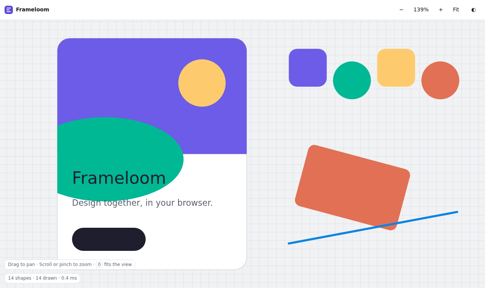
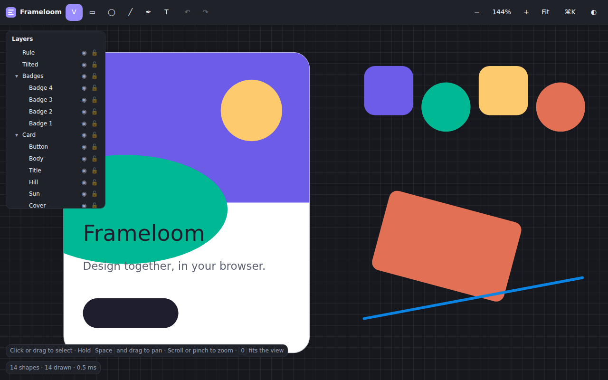

# Frameloom

> A collaborative vector design tool that runs entirely in your browser: no server, no account, no data leaves your device.

**Live demo:** https://striv11.github.io/frameloom/ (deployed by GitHub Pages)





## Problem

Design tools such as Figma and Excalidraw are either closed, server-bound or limited in scope. Designers and teams need a fast vector editor that opens instantly, works offline, and lets several tabs (and later, peers) edit the same document without a central authority.

## Motivation

Frameloom is a from-scratch exploration of the engineering inside a modern design tool:

- a **scene graph** with affine transforms, frames, groups and components;
- an **R-tree spatial index** so hit-testing and culling stay fast with 10k+ shapes;
- an **operation log** that powers undo/redo and sync;
- a hand-written **CRDT** so multiple tabs converge without conflicts;
- a **renderer** (Canvas2D now, WebGL2 later) with a performance budget enforced by a benchmark.

Everything is original code with no third-party runtime dependencies.

## Architecture

```
 input (pointer/keys)        src/main.ts, src/app
        │
        ▼
 tools ──► operations ──► SceneDocument ──► Canvas2DRenderer ──► <canvas>
 (planned)   (planned)     src/model          src/render/canvas2d
                              │  ▲
                              ▼  │
                      spatial index (src/spatial), CRDT, IndexedDB   (CRDT/IDB planned)
```

- `src/model/matrix.ts`: 2D affine math (`[a b c d e f]`), bounds, rect helpers.
- `src/model/types.ts`: node types (frame, group, rect, ellipse, line, text).
- `src/model/document.ts`: `SceneDocument`, a flat id → node table with parent/child links. Invariants: the root can't be removed or moved; only frames/groups hold children; reparenting can't create cycles; ids are unique. A node's local transform is `translate(x, y) · rotate(rotation)` about its top-left corner.
- `src/spatial/rtree.ts`: from-scratch R-tree (STR bulk load, incremental insert/remove/update, rect and point queries, `validate()` for invariants).
- `src/spatial/scene-index.ts`: indexes world bounds of a `SceneDocument`; `hitTest` returns the topmost visible, unlocked node under a point, honoring rotation and ellipse shape.
- `src/tools/transform.ts`: pure move/resize/rotate math. Resize maps the pointer into the node's starting local frame, so the opposite edge stays fixed for any rotation and any rotated parent; rotate sweeps the pointer angle around the node's center and keeps the center fixed; Shift keeps aspect (corners) or snaps to 15°.
- `src/tools/selection.ts`: `Selection`, group-aware picking (groups select as a unit, frame children directly) and marquee selection (frames must be fully enclosed).
- `src/tools/handles.ts` / `select-tool.ts`: selection frame and 8+1 handles (single node), union box for multi-select (move only); `SelectTool` is a DOM-free pointer state machine (click, shift-click, marquee, move, resize, rotate, cancel).
- `src/tools/create-tool.ts`: `CreateTool` (DOM-free) drag-to-create for rect/ellipse/line. The shape appears live, is parented to the topmost un-rotated frame under the pointer (positions converted to that frame's local space) and is discarded on a click without drag or on Esc. `shapeBox` holds the pure geometry: Shift = square, or 45° line snapping.
- `src/render/overlay.ts`: screen-space selection, hover, handles and marquee painted after the scene.
- `src/render/camera.ts`: world ↔ screen mapping with cursor-anchored zoom.
- `src/render/canvas2d.ts`: paint-order traversal with view-frustum culling, DPR-aware.

## Setup

Prerequisites: Node 22+.

```bash
npm ci
npm run dev        # http://localhost:5173
bash check.sh      # format, typecheck, lint, unit tests, build
npm run e2e        # Playwright (first: npx playwright install chromium)
```

Add `?stress=10000` to the URL to load 10,000 random shapes.

## Demo

Open the live link (or `npm run dev`). Click to select, Shift-click to add/remove, drag empty space for a marquee, drag a selection to move it, use the square handles to resize and the round handle to rotate (Shift = keep aspect / snap 15°), `Esc` cancels a drag or clears the selection. Hold Space (or middle-drag) to pan, scroll to pan, Ctrl/⌘+scroll or pinch to zoom, `0` to fit, `1` for 100%, `D` toggles light/dark. The HUD shows shape count, drawn shapes after culling, and frame time. Status: **Day 4 of 14**: select/move/resize/rotate plus creation tools. Press `V` select, `R` rectangle, `O` ellipse, `L` line (or use the toolbar), drag to draw, hold Shift for a square / 45° line, `Esc` cancels; the new shape is selected and the tool returns to Select. Resizing by handle is single-node only (lines and groups can be moved and rotated, not resized, until line endpoints / group scaling exist).

## Design decisions & trade-offs

- **Flat node table, not nested objects**: cheap id lookups, easy to serialize and to express as CRDT ops.
- **Rotation about the top-left corner**: keeps the local matrix trivial; resize/rotate tools will compensate.
- **Canvas2D first, WebGL2 later**: get correctness and tests first; the renderer sits behind a narrow interface.
- **Relative Vite base**: the static build works under any Pages sub-path.

## Roadmap

See [PLAN.md](PLAN.md) for the 14-day plan with acceptance criteria.

- [x] Day 1: scaffold, document model, pan/zoom canvas
- [x] Day 2: R-tree spatial index and hit-testing (hover name in HUD)
- [x] Day 3: selection and transform tools (move, resize, rotate)
- [x] Shape creation tools
- [ ] Undo/redo, pen tool, text, layers, inspector
- [ ] Grouping, frames, snapping
- [ ] CRDT, multi-tab collaboration, IndexedDB
- [ ] Components, export, command palette, WebGL2
- [ ] Landing, onboarding, benchmark, release

## License

MIT. See [LICENSE](LICENSE).
